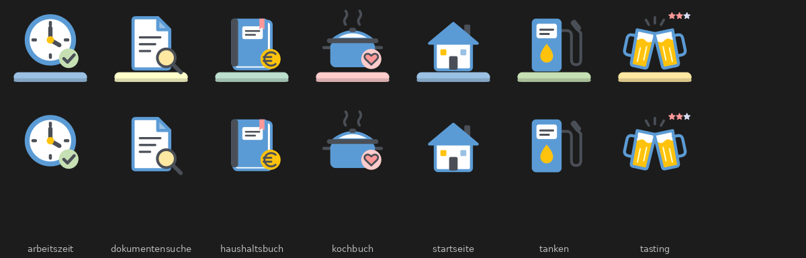

# Smart-Home-Icons

Zwei Rubriken im einheitlichen Farbstil:

- **Symbole** für Smart Home, Energie, Homeserver, Getränke und Essen: jedes Symbol isometrisch (3D), flach (2D) und als einfarbige Linie im Stil der Home-Assistant-Icons, 3D und 2D auch ohne Hintergrund.
- **Icons** in vereinfachtem, flachem Stil, z. B. als App-Icons: 2D mit und ohne Sockel.

## Formate

| Ordner | Inhalt |
|---|---|
| `src/3d`, `src/2d` | Symbole: farbige SVG-Quellen (200 × 200), frei skalierbar; 3D als echte Isometrie |
| `src/mono` | Symbole: einfarbige Linien-Icons (24 × 24, `currentColor`), Grundlage für Home Assistant (`shi:`) |
| `frei/3d`, `frei/2d` | Symbole ohne Hintergrund (3D ohne Bodenplatte, 2D ohne Sockel), automatisch erzeugt |
| `png/3d`, `png/2d`, `png/3d-frei`, `png/2d-frei`, `png/mono` | PNG in 64 und 256 px |
| `cricut` | Symbole in 2D für Schneideplotter (z. B. Cricut): nur Flächen, eine Ebene je Farbe, 100 mm groß |
| `icons/src` | Icons: farbige SVG-Quellen (200 × 200) mit Sockel |
| `icons/frei` | Icons ohne Sockel, automatisch erzeugt |
| `icons/png/2d`, `icons/png/2d-frei` | Icons als PNG in 64 und 256 px |
| `icons/png/app` | Icons auf weißem Grund in 1024 px, Ausgangsbild für App-Icons |
| `icons/cricut` | Icons für Schneideplotter, wie `cricut` |

## Verwendung

- Webseiten und Apps: SVG direkt einbinden, z. B. `https://raw.githubusercontent.com/LinnFidelius/smart-home-icons/main/src/2d/pv.svg`
- Home Assistant als Icon-Set: über den Marketplace (Typ Dashboard) installieren, danach in jedem Symbolfeld `shi:<name>` eintragen, z. B. `shi:waermepumpe`
- Home Assistant: in der [Energiefluss Card](https://github.com/LinnFidelius/energiefluss-card) sind alle Symbole bereits eingebaut
- Plotter: Datei aus `cricut` in Design Space hochladen; jede Farbe ist eine eigene Ebene

## Bauen

`python3 tools/build.py` erzeugt PNGs, Varianten ohne Hintergrund, Cricut-Dateien und die Übersichten aus `src` und `icons/src` (benötigt `cairosvg`, `picosvg`, `Pillow`).

## Feedback

Wünsche und Fehler gerne über [Issues](../../issues/new/choose) melden (GitHub-Konto nötig). In der Energiefluss Card führt auch der Link unten im Karten-Editor dorthin.

## Hinweise

- Alle Symbole wurden mit Claude (KI von Anthropic) erstellt und vom Betreiber des Repositorys geprüft.
- Allgemeine Darstellungen, keine Nachbildungen von Marken oder Logos.
- Ohne Gewähr; Nutzung auf eigene Verantwortung.

## Lizenz

MIT, siehe [LICENSE](LICENSE).
