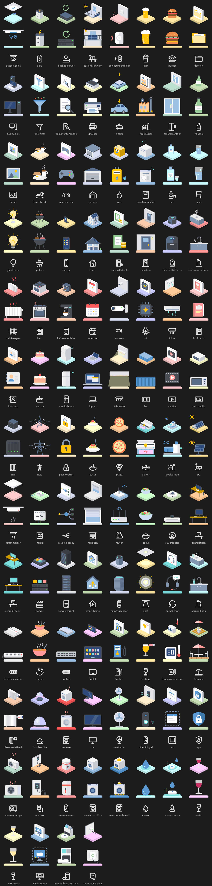

# Smart-Home-Icons

Symbole für Smart Home, Energie, Homeserver, Getränke und Essen im einheitlichen Stil: jedes Symbol isometrisch (3D), flach (2D) und als einfarbige Linie im Stil der Home-Assistant-Icons.

## Formate

| Ordner | Inhalt |
|---|---|
| `src/3d`, `src/2d` | farbige SVG-Quellen (200 × 200), frei skalierbar |
| `src/mono` | einfarbige Linien-Icons (24 × 24, `currentColor`) |
| `png/3d`, `png/2d`, `png/mono` | PNG in 64 und 256 px |
| `cricut` | 2D-Variante für Schneideplotter (z. B. Cricut): nur Flächen, eine Ebene je Farbe, 100 mm groß |

## Verwendung

- Webseiten und Apps: SVG direkt einbinden, z. B. `https://raw.githubusercontent.com/LinnFidelius/smart-home-icons/main/src/2d/pv.svg`
- Home Assistant als Icon-Set: über den Marketplace (Typ Dashboard) installieren, danach in jedem Symbolfeld `shi:<name>` eintragen, z. B. `shi:waermepumpe`
- Home Assistant: in der [Energiefluss Card](https://github.com/LinnFidelius/energiefluss-card) sind alle Symbole bereits eingebaut
- Plotter: Datei aus `cricut` in Design Space hochladen; jede Farbe ist eine eigene Ebene

## Bauen

`python3 tools/build.py` erzeugt PNGs, Cricut-Dateien und die Übersicht aus `src` (benötigt `cairosvg`, `picosvg`, `Pillow`).

## Hinweise

- Alle Symbole wurden mit Claude (KI von Anthropic) erstellt und vom Betreiber des Repositorys geprüft.
- Allgemeine Darstellungen, keine Nachbildungen von Marken oder Logos.
- Ohne Gewähr; Nutzung auf eigene Verantwortung.

## Lizenz

MIT, siehe [LICENSE](LICENSE).
